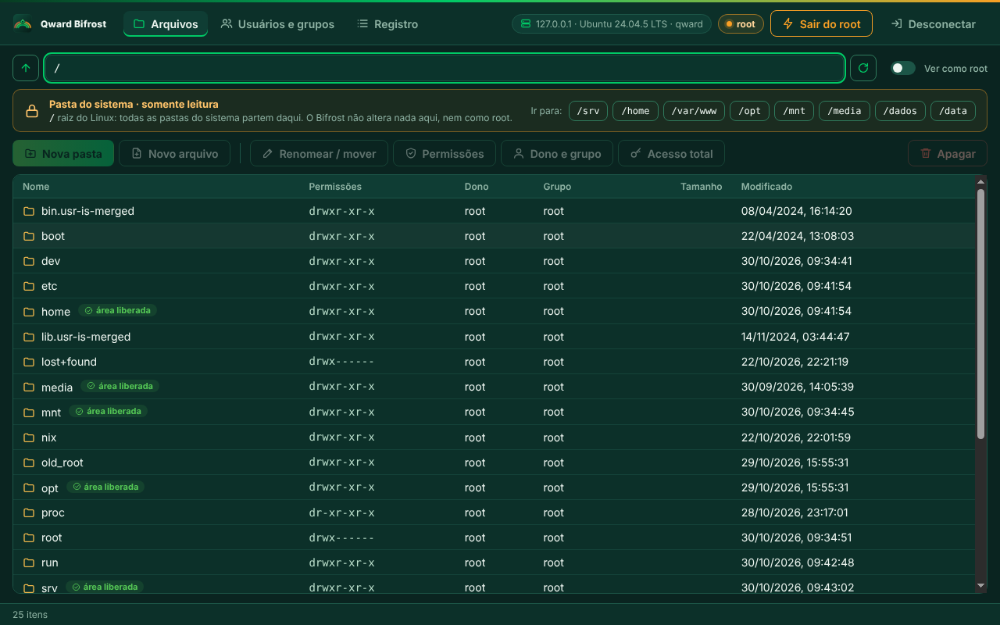
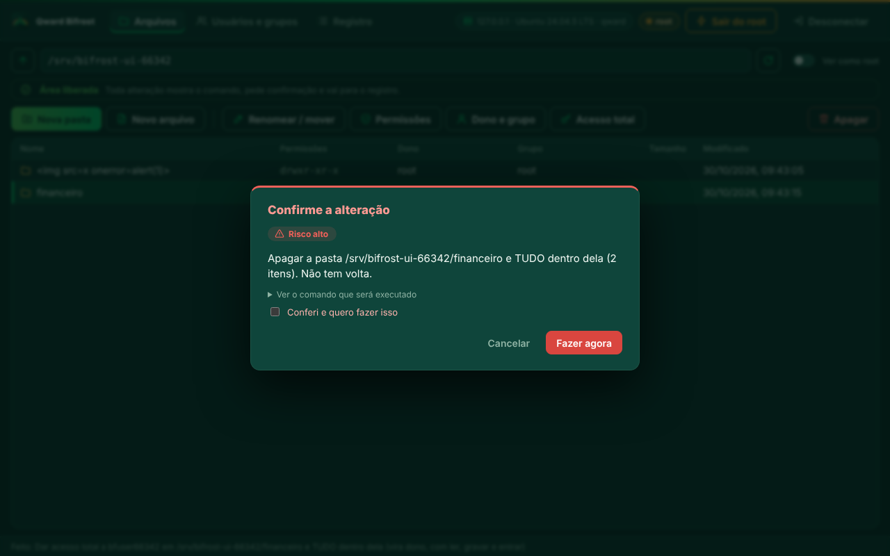
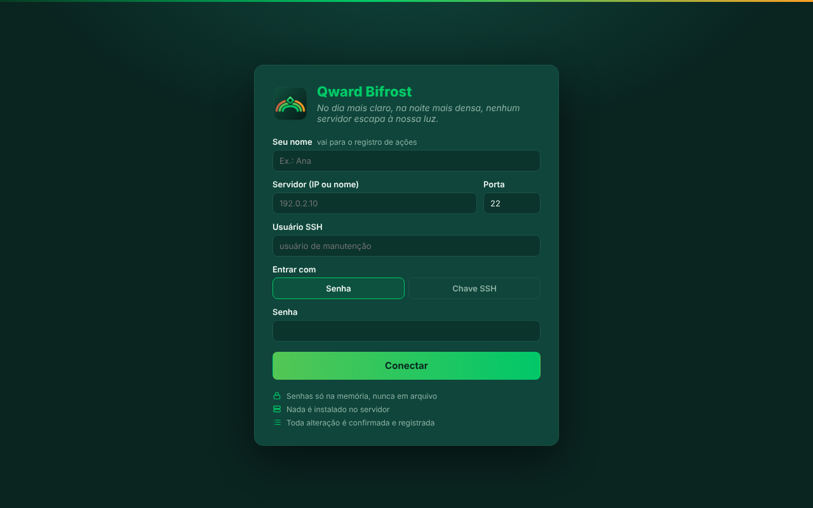

<p align="center">
  
</p>

<h1 align="center">Qward Bifrost</h1>

<p align="center"><em>No dia mais claro, na noite mais densa, nenhum servidor escapa à nossa luz.</em></p>

<p align="center">
  Gerência de servidores Linux por SSH, com interface gráfica, para os técnicos da Qward.<br>
  Versão <strong>0.3.0</strong> · Windows · portátil (não precisa instalar)
</p>

---

## Por que existe

Pastas, permissões, donos, grupos e usuários de servidores Linux costumam exigir o terminal, que poucos técnicos dominam. O Bifrost põe essas tarefas numa tela simples, **com travas que impedem os erros caros** (mexer em pasta do sistema, apagar sem querer, dar poder de administrador a quem não deve) e **registro de tudo o que foi feito**.

**Nada é instalado no servidor.** O Bifrost usa só o SSH e comandos que já existem em qualquer Linux (Debian, Ubuntu, Rocky, Alpine/BusyBox).

<p align="center">
  
</p>

## O que ele faz

| Área | Funções |
|---|---|
| **Arquivos** | navegar, criar pasta ou arquivo vazio (com permissão), renomear/mover sem sobrescrever, apagar com confirmação digitada |
| **Permissões** | grade Ler/Escrever/Entrar para dono, grupo e outros; número octal; "pastas novas herdam o grupo" (setgid); recursivo |
| **Dono e grupo** | trocar dono, grupo ou os dois; **Acesso total** dá a um usuário controle de uma pasta sem dar root |
| **Usuários e grupos** | listar, criar usuário (grupos, shell, pasta pessoal, senha), criar grupo, colocar usuário em grupo, definir senha |
| **Elevação** | entra como usuário comum e eleva para root (`su`, ou `sudo` se o root estiver bloqueado) só quando precisa |
| **Registro** | toda ação fica gravada no PC: quem, quando, servidor, o quê e o resultado (nunca senhas) |

## Segurança por padrão

- **Área liberada:** alterações só dentro de `/srv`, `/home`, `/var/www`, `/opt`, `/mnt`, `/media`, `/dados` e `/data` (configurável). `/`, `/bin`, `/etc`, `/usr`, `/boot` e o resto do sistema são **somente leitura**, mesmo como root. A tela avisa antes do clique e o núcleo confere de novo, resolvendo atalhos no servidor.
- **Chaves SSH protegidas:** nada dentro de `.ssh` é alterado.
- **Sem poder de administrador por engano:** grupos como `sudo`, `wheel` e `docker` ficam bloqueados; setuid também.
- **Confirmação com o comando à vista:** toda alteração mostra o que vai acontecer, o nível de risco e o comando exato. Risco alto pede um "Conferi" extra; apagar pede o nome digitado.
- **Identidade do servidor** conferida na primeira conexão e cobrada nas próximas.
- **Senhas só na memória**, nunca em arquivo, registro ou linha de comando.

<p align="center">
  
</p>

Detalhes em [docs/seguranca.md](docs/seguranca.md).

## Para usar (técnico)

1. Baixe o **`QwardBifrost.exe`** em [Releases](../../releases) (ou em **Actions → exe-windows → última execução → Artifacts**).
2. Dê dois cliques. Não precisa instalar.
3. Siga o [manual do técnico](docs/manual-do-tecnico.md).

<p align="center">
  
</p>

## Como funciona

```
Tela (HTML/CSS/JS) ──IPC fechado──> Processo principal (Electron) ──> Núcleo ──SSH──> Servidor Linux
                                                                      │
                                     validação · política de pastas · aspas POSIX · registro local
```

Toda operação passa por `Ops.plan()` (valida, confere a política e monta o comando com aspas seguras) antes de `Ops.execute()` (roda e registra). Mais em [docs/arquitetura.md](docs/arquitetura.md).

## Para desenvolver

Requisitos: Node 20+ (testado com 22 e 24).

```bash
npm ci
npm start          # abre o app
npm test           # testes do núcleo (precisa de servidor SSH de teste, veja docs/testes.md)
npm run test:ui    # ponta a ponta da interface (Playwright + Electron), salva capturas
npm run dist       # gera dist/QwardBifrost.exe
```

Cada push gera o `.exe` no Windows pelo GitHub Actions; uma tag `vX.Y.Z` publica a Release.

## Documentação

| Documento | Para quem |
|---|---|
| [Manual do técnico](docs/manual-do-tecnico.md) | quem usa: passo a passo, sem jargão |
| [Segurança](docs/seguranca.md) | travas, política de pastas e registro |
| [Arquitetura](docs/arquitetura.md) | como as peças se encaixam |
| [Compatibilidade](docs/compatibilidade.md) | distros testadas e comandos usados |
| [Testes](docs/testes.md) | como testar e o que já foi testado |
| [Decisões (ADR)](docs/adr/) e [pendências](docs/pendencias.md) | escolhas feitas e o que está em aberto |
| [CHANGELOG](CHANGELOG.md) | o que mudou em cada versão |

## Regras do repositório

Nenhum dado de cliente aqui: nada de IP, senha, nome de cliente ou ficha. Exemplos usam endereços de documentação (`192.0.2.x`). Credenciais de teste vêm de variáveis de ambiente.

---

<p align="center"><sub>Qward Tecnologia · uso interno</sub></p>
