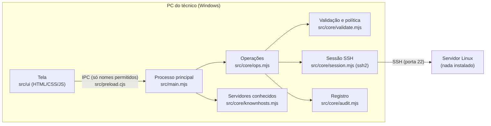

# Arquitetura

## Peças

| Arquivo | Papel |
|---|---|
| `src/main.mjs` | Electron: cria a janela, guarda a sessão, carrega `politica.json`, responde à tela via IPC |
| `src/preload.cjs` | ponte mínima: expõe só `window.bifrost.call(nome, args)` com lista fechada de nomes |
| `src/ui/` | tela; dado do servidor entra só por `textContent` (nunca `innerHTML`) |
| `src/core/session.mjs` | conexão (senha, chave, keyboard-interactive), verificação da chave do servidor, `run()` com elevação `sudo -S` ou `su` em pty |
| `src/core/ops.mjs` | cada operação tem `plan()` (resumo + comando + risco) e `execute()` (roda e registra) |
| `src/core/validate.mjs` | aspas POSIX, validação de caminho/nome/modo, política de pastas |
| `src/core/audit.mjs` | registro JSON por linha |
| `src/core/knownhosts.mjs` | impressões digitais confirmadas |

## Fluxo de uma alteração

1. Tela coleta os dados → `plan(op, args)`.
2. Núcleo valida nomes e modos, **resolve links no servidor** (`readlink -f`) e checa a política.
3. Tela mostra resumo, risco e comando → técnico confirma.
4. `execute(op, args)` refaz o plano (não confia no anterior), roda com elevação e grava o registro.

## Elevação

- **sudo**: `sudo -S -k -p '' -- sh -c '<script>'`, senha pela entrada padrão (nunca na linha de comando). `-k` força pedir a senha sempre, o que deixa o comportamento previsível.
- **su**: `su -c '<script>' root` num pseudo-terminal; o Bifrost espera o prompt de senha (pt, en, es, de, fr), responde e separa a saída por um marcador.
- A elevação é testada ao conectar (`id -u` precisa dar `0`).

## Dados no PC do técnico

Em `%APPDATA%\Qward Bifrost\`:

| Arquivo | Conteúdo |
|---|---|
| `politica.json` | pastas permitidas (editável pelo responsável) |
| `servidores-conhecidos.json` | `host:porta` → impressão digital |
| `registro-de-acoes.jsonl` | registro de ações (sem senhas) |

`BIFROST_DATA_DIR` troca essa pasta (usado nos testes).
